# Cyclistic case study: how do casual riders and annual members use the bikes differently?

Google Data Analytics Capstone, track 1. The work follows the six phases of the course (Ask, Prepare, Process, Analyse, Share, Act). Each phase has a notebook in `src/`, the charts are in `figs/`, and my working notes are in `(Notes) Case Study - Cyclistic.pdf`.

## Summary

Cyclistic's marketing director, Moreno, wants strategies that turn casual riders into annual members. The first step is to understand how the two groups ride, so I analysed 6.17 million Divvy trip records from October 2025 to September 2026. After cleaning I kept 6.01 million rides, 65% by members and 35% by casual riders. The two groups use the bikes differently. Members ride on weekdays, mostly at commute hours, and the busiest days are Tuesday to Thursday. Casual riders peak on Saturdays and in July, start at the lakefront and tourist spots like Navy Pier, ride longer (median 11.1 min against 8.7) and are 3.4 times as likely to end where they started. Their ridership is also far more seasonal: from summer to winter their rides fall 91%, against 74% for members. To go beyond descriptive charts I trained a neural network to predict rider type, explained it with SHAP, and looked at casual rides the model scores as member-like. Over half of those start at commute hours, against under a quarter of typical casual rides. That group is where I would start.

## Ask

Moreno's goal: design marketing strategies aimed at converting casual riders into annual members. The brief poses three guiding questions:

1. How do annual members and casual riders use Cyclistic bikes differently?
2. Why would casual riders buy Cyclistic annual memberships?
3. How can Cyclistic use digital media to influence casual riders to become members?

This project answers only the first. The trip data records what riders do, so it can describe differences in usage. It has no demographics, prices, surveys or marketing channel data, which questions 2 and 3 would need. The recommendations below are limited to what the usage differences support.

## Prepare

The data is Divvy's public trip data for the fictional company Cyclistic, covering 2025-10 to 2026-09. One monthly file is mislabeled: the zip named `2025-01` contains the 2025-12 and 2026-01 data. Raw data has 6,171,785 rows and 13 columns (notebook `src/prepare.ipynb`).

I checked it against ROCCC:

- Reliable: mostly, with caveats. 20.9% of rows lack the start station and 22% lack the end station. For e-bikes, 30.8% lack end station info and 29.4% lack start station info, against 0.3% of end station info for classic bikes. A likely reason is that e-bikes are not always docked at a station. There are 35 duplicate rows, 29 rides that start after they end, and 2.58% of rides are under 1 minute. Members are 64.5% of the records, so casual riders are underrepresented. The share of nulls falls from October to February and rises from March to August, which looks like seasonality.
- Original: yes, these are first-party trip records.
- Comprehensive: enough for the question asked, but there is no demographic or climate data, which limits any explanation of why riders behave as they do.
- Current: yes, the latest 12 months.
- Cited: Divvy's public trip data.

About 98.91% of rides are inside Chicago.

## Process

Notebook `src/process.ipynb`. Cleaning steps:

- Converted timestamps from string to datetime and trimmed whitespace in text columns.
- Removed 35 duplicates, rides that last under 1 minute (159,221), and rides of 24 hours or more (5,317). For the 24-hour cutoff I compared ride length percentiles by rider type: p99.99 is almost the same for members and casual riders, which suggests an artificial ceiling.
- Removed 308 rides with no end station information at all.
- In total 164,881 records were excluded and 6,006,904 remain.
- Kept rides outside Chicago but flagged them with `start_inside_chicago` and `end_inside_chicago`.
- Added 13 columns: ride length, day of week, start and end hour, month, season, weekend flag, round-trip flag, haversine distance, the two Chicago flags and the two station flags.

The member and casual split moved from 64.5% / 35.5% to 64.9% / 35.1%, and `ride_id`, `started_at`, `ended_at`, `rideable_type` and `member_casual` have no nulls left. The cleaned file is saved in `data/processed/`.

## Analyse

Notebook `src/analyse.ipynb`.

Overall: 64.9% of rides are by members and 35.1% by casual riders. 70.4% are on e-bikes. Ride length has a long right tail (mean 14.3 min, median 9.43 min, standard deviation 26.9 min), and the 75th, 90th, 99th and 99.9th percentiles are 16.28, 27.17, 79.03 and 245.53 minutes. Distances do not differ much between rider types. Rides are longer in summer (median 10.32 min) than in winter (7.42 min).

| | Casual riders | Members |
|---|---|---|
| Average / median ride | 18.13 / 11.13 min | 12.16 / 8.68 min |
| Round trips | 7.41% | 2.21% |
| Busiest day | Saturday, then Sunday and Friday | Wednesday, then Tuesday and Thursday |
| Busiest month | July, then August and June | August, then July and September |
| Busiest hour | 5 pm to 6 pm | 5 pm to 6 pm |
| Share of rides in summer / winter | 46.36% / 4.31% | 37.35% / 9.66% |

The most used stations overall are Navy Pier, DuSable Lake Shore Dr & Monroe St, and Michigan Ave & Oak St.

## Share

Notebook `src/share.ipynb`. Members are blue and casual riders are red in every chart.

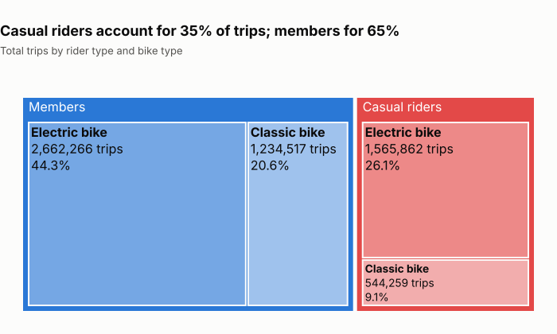

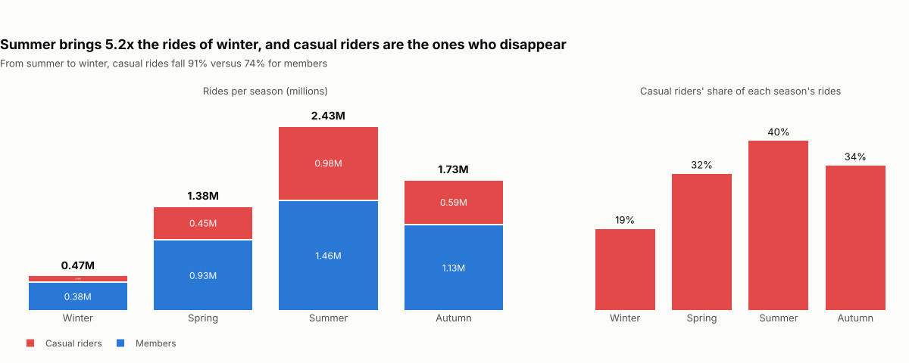

Summer brings 5.2 times the rides of winter, and casual riders are the ones who disappear: their rides fall 91% from summer to winter, against 74% for members.

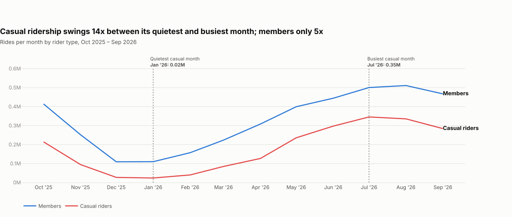

Casual ridership swings 14x between its quietest and busiest month. Members swing 5x.

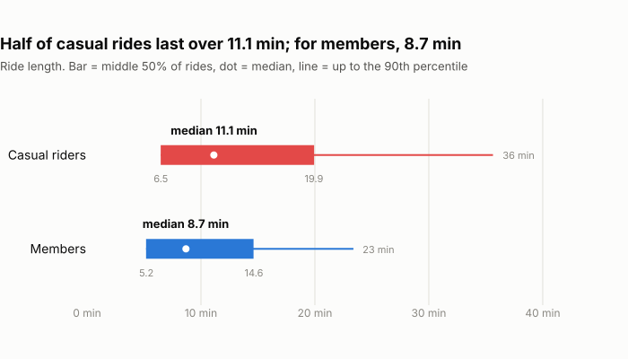

Half of casual rides last over 11.1 minutes. For members it is 8.7.

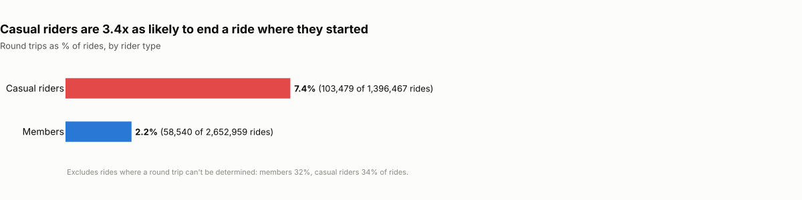

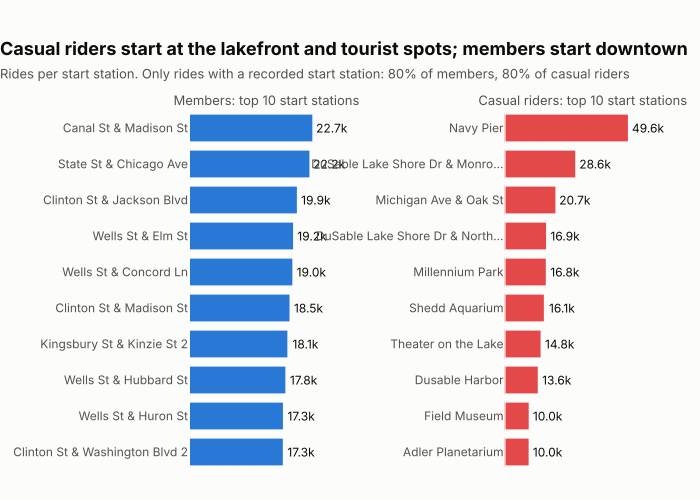

Casual riders start at the lakefront and tourist spots, members downtown. Navy Pier alone has 49,555 casual starts.

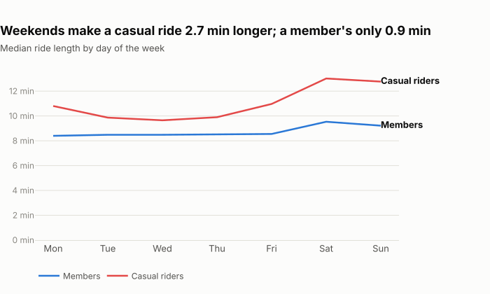

Weekends make a casual ride 2.7 minutes longer, and a member's ride only 0.9 minutes longer.

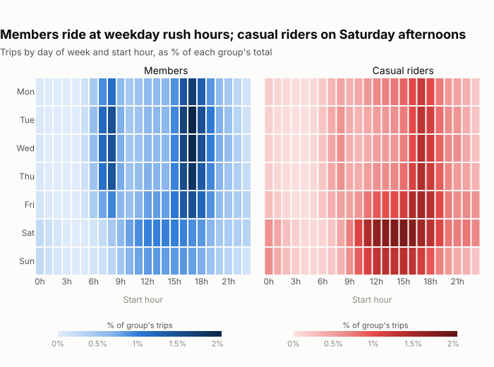

Members ride at weekday rush hours, casual riders on Saturday afternoons.

## Act: modelling casual riders who look like members

Notebook `src/model_a.ipynb`. Descriptive charts show how the groups differ on average, but not which casual rides look most like member rides. I trained a classifier to predict rider type, then used its scores to find those rides.

- Features: sin/cos encoding for hour, weekday and month, plus weekend flag, log ride length, distance, round trip, bike type, start coordinates and station flags. The split is stratified: 70% train, 10% validation and 20% test.
- Models: gradient boosting (AUC 0.7451), XGBoost (0.7514) and an MLP in Keras (0.7297). The ranking power is moderate, so I treat the model as a way to describe patterns, not to score people.
- Leakage check: bike type and the missing-station flags may reflect how the data was recorded rather than rider behaviour. An MLP trained without them reached AUC 0.7135, a small drop, so the patterns are mostly behavioural.
- Explanation: SHAP on the MLP, with sin/cos pairs added back together. Ride length and distance carry 43% of what the model uses. XGBoost's exact TreeExplainer ranks features similarly (rank correlation 0.71).

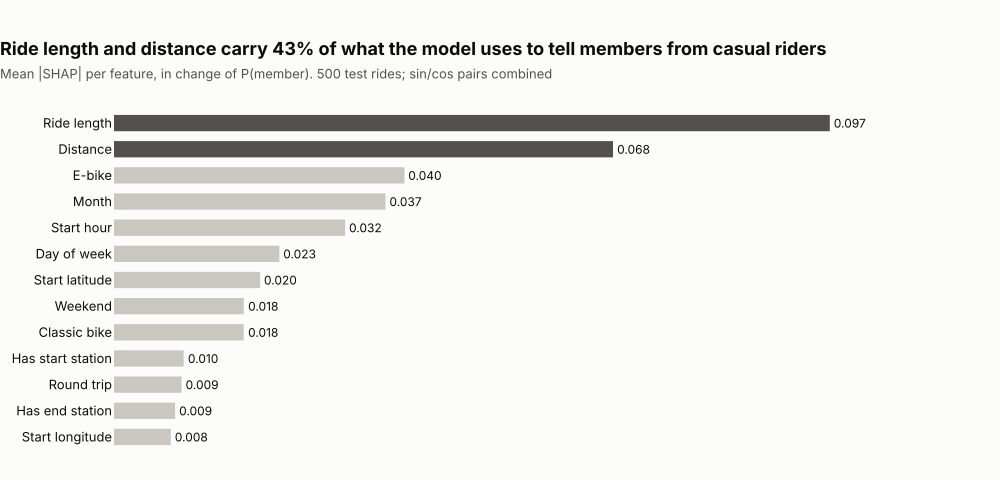

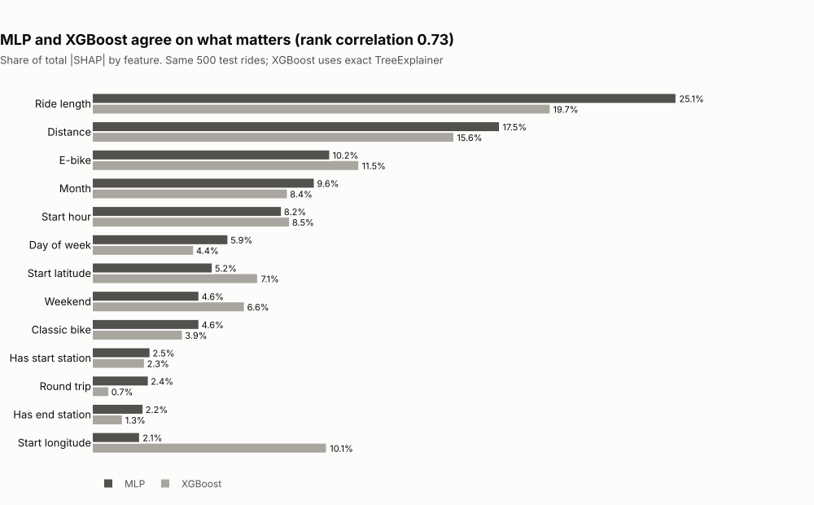

Among casual rides in the test set, rides with P(member) of 0.7 or more are "almost member" (106,054 rides), and rides below 0.3 are "typical casual" (57,327 rides). The cutoffs are my own choice.

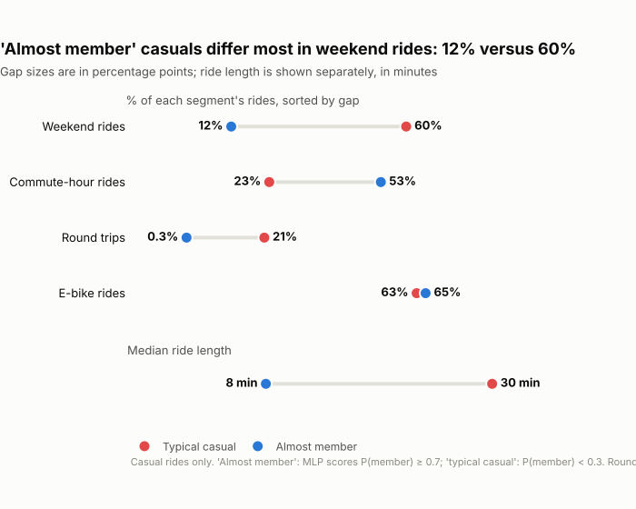

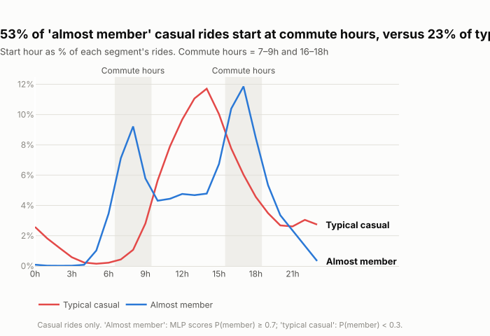

| | Typical casual | Almost member |
|---|---|---|
| Median ride | 29.6 min | 7.8 min |
| Weekend rides | 59.7% | 12.4% |
| Round trips | 21.3% | 0.3% |
| Start at commute hours (7-9h, 16-18h) | 22.7% | 52.8% |
| E-bike | 62.5% | 64.9% |

## Top three recommendations

These come from the answer to the first question, how the two groups use the bikes differently.

1. Focus on casual riders who already ride like members. The "almost member" group makes short weekday trips, mostly at commute hours, with almost no round trips. Their usage already looks like a member's, so they are the closest group to converting.
2. Treat leisure riders as a separate group with a seasonal offer, such as a warm-season membership, instead of pushing only the annual pass. Typical casual riders ride long, mostly on weekends, and 46% of their rides fall in summer against 4% in winter. They start at the lakefront and tourist spots (Navy Pier and the Lake Shore Drive stations lead). This needs a pilot.
3. Time any campaign to the season. Casual ridership swings 14x between its quietest and busiest month, members only 5x. Casual volume is highest from May to September, which is when a campaign reaches the most casual riders.

These are hypotheses drawn from ride-level data, and none has been tested.

## Next steps

- Run a small pilot of recommendations 1 and 2 against a control group and compare conversion.
- Add an anonymous rider ID, so one casual rider's repeat rides can be linked. This turns "almost member" from a property of a ride into a property of a person.
- Revisit the model with richer features. Questions 2 and 3 would need other data (pricing, demographics, surveys, marketing channels), which this dataset does not have.

## Limitations

- Each row is a ride, not a rider, so "almost member" describes a ride, not a person.
- About a fifth of rides have no start station, and e-bikes are the main source of the gaps, so station rankings cover only the remaining rides.
- The segment depends on a model of moderate accuracy and on cutoffs I chose.
- The analysis shows what riders do, not why they do it.

## Reproducing the analysis

Requires Python 3.13 and [uv](https://docs.astral.sh/uv/).

```bash
uv sync
```

Put the monthly Divvy trip CSVs in `data/raw/`, then run the notebooks in `src/` in this order: `prepare`, `process`, `analyse`, `share`, `model_a`. Charts are saved as SVG to `figs/` with Plotly and Kaleido.

Stack: Polars, Plotly, scikit-learn, XGBoost, TensorFlow/Keras and SHAP.
